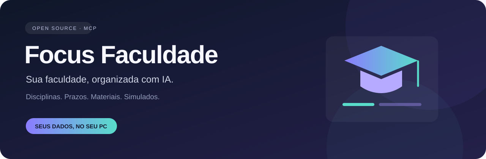
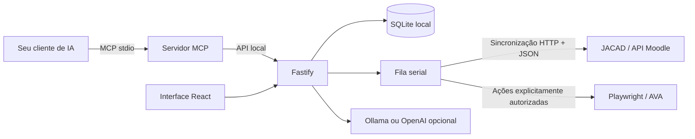

<p align="center"></p>

<p align="center">
  <a href="https://github.com/MaxsuelOliveira/focus-faculdade/actions"></a>
  
  
  
  <a href="LICENSE"></a>
</p>

<p align="center"><strong>Disciplinas, prazos, materiais e simulados em um só lugar.<br>Conecte seu assistente de IA pelo MCP e mantenha seus dados no seu computador.</strong></p>

---

O **Focus Faculdade** é um aplicativo pessoal para alunos da Faculdade Focus. Reúne informações do AVA, organiza o estudo e oferece um servidor MCP para assistentes compatíveis consultarem avaliações e materiais, explicarem questões e salvarem simulados locais.

Projeto independente, sem vínculo oficial com a instituição. Cada aluno usa sua própria conta. O repositório contém código e exemplos; credenciais, sessões e dados acadêmicos ficam fora do Git.

## O que você pode fazer

### Aprender e consumir

O novo fluxo reúne seleção de disciplinas, consumo rastreável dos materiais, resumo, mapa mental, slides e simulados locais. A direção visual foi aprovada; a integração e a validação com a disciplina piloto continuam em andamento. Vídeos sem transcrição permanecem identificados como pendentes.

Veja a [arquitetura, telas e estado da implementação](documents/learning-system.md) e o [rascunho do artigo](documents/articles/learning-with-sources-draft.md). O protótipo é servido pelo Vite em `/documents/prototypes/learning/index.html`; os exemplos dele não são materiais extraídos do AVA.

| Recurso                  | Como ajuda                                                        |
| ------------------------ | ----------------------------------------------------------------- |
| Disciplinas e avaliações | Consulte cursos descobertos, regras e estado das tentativas.      |
| Calendário               | Veja os prazos conhecidos e identifique avaliações sem data.      |
| Simulados com IA         | Cole perguntas, receba explicações e salve seu gabarito.          |
| Materiais                | Use textos do AVA e conteúdos adicionados por você como contexto. |
| Checklists               | Acompanhe tarefas e notas com persistência local.                 |
| MCP                      | Use 27 ferramentas, um recurso e um prompt no seu cliente de IA.  |
| Backup e exportação      | Faça cópias do SQLite e exporte seus dados e respostas.           |

## Comece em poucos passos

Você precisa de **Node.js 24+**, npm, Git e uma conta própria no portal.

```sh
git clone https://github.com/MaxsuelOliveira/focus-faculdade.git
cd focus-faculdade
npm ci
npm run browser:install
```

Copie `.env.example` para `.env`. No PowerShell:

```powershell
Copy-Item .env.example .env
```

Edite o arquivo localmente e preencha `USERNAME` e `PASSWORD`. Configure `AVA_COURSE_URL` com o link de uma disciplina sua. **Não envie o `.env` para chats, issues ou GitHub.** No Windows, o aplicativo lê o login acadêmico do arquivo, sem confundir com o `USERNAME` do sistema.

```sh
npm run build
npm start
```

Abra **[http://127.0.0.1:4317](http://127.0.0.1:4317)** e mantenha o aplicativo aberto. Use o IP literal; `localhost` não está entre as origens permitidas. A sincronização autentica por HTTP e consulta exclusivamente a API JSON do Moodle, sem abrir navegador. Se a instituição exigir CAPTCHA/MFA ou negar um serviço, a operação informa o impedimento e mantém o snapshot anterior, sem fallback visual.

Os contratos observados, campos disponíveis e limites estão em [API do portal](documents/PORTAL-API.md). O [OpenAPI](documents/portal-api.openapi.json) também fica disponível em `/api/portal/openapi`. Valores ausentes na API são apresentados como desconhecidos; não há promessa de precisão absoluta sobre dados que o portal não disponibiliza.

> Usa Codex com política RTK? Prefixe os comandos com `rtk proxy`, como em `rtk proxy npm.cmd run build`.

## Conecte sua IA com MCP

O MCP não exige chave de API: o modelo do seu cliente pode consultar o conteúdo e preparar respostas. Ollama e OpenAI são alternativas opcionais dentro do aplicativo.

**Codex:** substitua `/CAMINHO/` pelo caminho absoluto do projeto:

```sh
codex mcp add focus-faculdade --env FOCUS_MCP_PORT=4317 -- node /CAMINHO/focus-faculdade/dist/server/mcp-stdio.js
```

Para clientes com configuração JSON:

```json
{
  "mcpServers": {
    "focus-faculdade": {
      "command": "node",
      "args": ["/CAMINHO/focus-faculdade/dist/server/mcp-stdio.js"],
      "env": { "FOCUS_MCP_PORT": "4317" }
    }
  }
}
```

No Windows, um caminho como `C:/projetos/focus-faculdade/dist/server/mcp-stdio.js` funciona. Se necessário, informe o caminho absoluto de `node.exe`. O aplicativo precisa continuar aberto. A conexão é **local por stdio**; chats sem suporte a MCP local não se conectam diretamente.

Experimente pedir:

- “Mostre minhas disciplinas e a última sincronização.”
- “Quais avaliações têm prazo nesta semana? Quais estão sem data?”
- “Consulte os materiais da avaliação e prepare um simulado com explicações.”
- “Salve minhas respostas como rascunho, sem aprovar nem enviar.”

Se uma disciplina não aparecer, use `portal_job` com `kind: "sync"` e `course_external_id` igual ao ID do link `course/view.php?id=...`. Essa opção consulta uma disciplina específica sem depender da navegação da disciplina inicial.

## Instale a skill pelo GitHub

A skill está em [`skills/focus-faculdade`](skills/focus-faculdade/SKILL.md). No Codex com Skill Installer, peça:

> Instale a skill do repositório https://github.com/MaxsuelOliveira/focus-faculdade, no caminho skills/focus-faculdade.

Alternativamente, copie a pasta `skills/focus-faculdade` para `~/.codex/skills/focus-faculdade`. Reinicie o cliente para carregar a skill e use `$focus-faculdade`.

**Skill e MCP se complementam:** a skill orienta o assistente; o MCP executa consultas. Instalar a skill não instala dependências, não configura credenciais e não inicia o aplicativo.

## Dados privados por padrão

- `.env`, SQLite, backups, cookies e perfil do navegador ficam no computador do aluno.
- `data/`, `academic/`, `private/` e capturas geradas são ignorados pelo Git.
- Sugestões, respostas, aprovação e entrega são etapas distintas.
- Iniciar prova pode consumir tentativa e iniciar cronômetro; exige confirmação específica.
- Entrega exige respostas revisadas e token de uso único. Uma entrega incerta não é repetida automaticamente.
- Uma IA externa recebe os dados que você autorizar consultar; Ollama permite processamento local.

Veja [SECURITY.md](SECURITY.md) e rode `npm run privacy:check` antes de publicar contribuições.

## Arquitetura



O MCP reutiliza a API e não abre outro banco ou worker. O backend roda em loopback; não é um serviço multiusuário e não deve ser exposto na internet sem autenticação própria.

## Desenvolvimento e contribuição

```sh
npm run dev
npm run typecheck
npm run lint
npm test
npm run build
npm run privacy:check
```

Testes usam dados fictícios e bancos temporários, sem iniciar avaliações reais. E2E exigem a porta 4317 livre: feche o aplicativo pessoal antes de executá-los. Consulte [CONTRIBUTING.md](CONTRIBUTING.md).

## Documentação e limites

- [Ferramentas e configuração MCP](documents/MCP.md)
- [Integração HTTP e API estruturada do portal](documents/PORTAL-API.md)
- [Contrato OpenAPI](documents/portal-api.openapi.json)
- [Operação local, IA, backups e recuperação](documents/OPERATIONS.md)
- [Segurança e privacidade](SECURITY.md)
- [Como contribuir](CONTRIBUTING.md)
- [Licença MIT](LICENSE)

A descoberta de cursos depende do acesso da conta e das páginas conhecidas. O calendário contém prazos conhecidos das avaliações, não todo o calendário institucional. A extração textual não interpreta automaticamente imagens, PDFs, vídeos ou SCORM. Questões com editor rico, anexos e tipos especiais podem exigir intervenção manual. Mudanças no portal podem exigir atualização dos adaptadores. Respostas de IA precisam de revisão.

Encontrou um problema? Abra uma issue com um exemplo fictício. Quer ajudar outros alunos? Contribua com acessibilidade, documentação, testes e compatibilidade — sem dados pessoais.

A aprendizagem agora inclui geração local pelo Ollama, legendas de vídeo com timestamps, reconhecimento opcional de áudio e OCR local de imagens. O caderno oferece mapa em árvore, slides, resumo e simulado com fontes, além de exportações Markdown/SVG/HTML. Escolha explicitamente um modelo instalado; materiais inacessíveis e exclusões aparecem como limites de cobertura. Consulte [configuração e evidências](documents/learning-system.md) e o [artigo técnico](documents/articles/learning-with-sources-draft.md).
